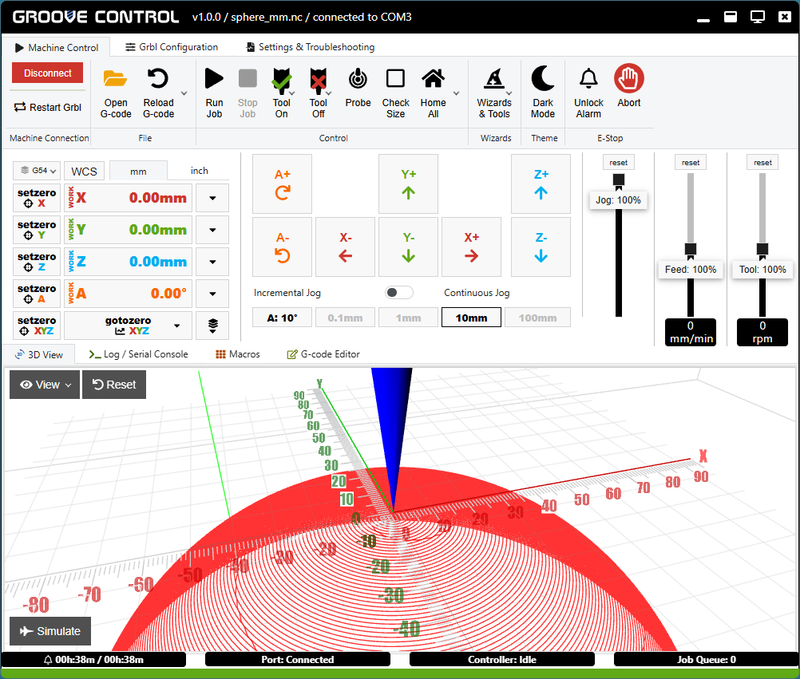

# Groove Control
Groove Control is a G-code sender software for CNC machines running Grbl, GrblHAL, and FluidNC.

It is the spiritual successor of the popular OpenBuilds CONTROL software.
It builds on what made the original great - its simple and extremely approachable interface -
and takes it to the next level of polish, safety and usability.

Every feature has been enhanced. Frustrating bugs and quirks have been fixed. The job control is improved and more reliable.
New features like the file history, origin history, a macro manager, a heightmap tool,
and a slick job simulator fit seamlessly into the existing design.

## Download

**Latest version**

You can find the latest version here: [Latest Release](releases/latest)

**Older versions**

See all past versions here: [All Releases](releases)

**Few things to keep in mind**

* The Windows binaries are unsigned. You will have to work around the Smart Screen restrictions to get it running. 
Signing the installer requires a certificate, which is not free.
One will be added in the future, but at this time I can't justify the expense until I know that enough people are even going to use it

* The Mac binaries are completely untested and not notarized. I don't have a Mac to test them.
If you are a Mac developer and you are willing to help get things started, let me know

## Changes in Groove Control

Here are the major changes from the original OpenBuilds CONTROL

### Workflow

* **New Feature:** Ability to view and set machine coordinates
* **New Feature:** Stores a history of work origins and allows for rolling back to a previous one
* **New Feature:** While the job is paused, the Tool Off button can stop the spindle. It will resume automatically
* **New Feature:** A new setting to insert a delay for a few seconds after the spindle starts up
* **Improvement:** Corrected the calculations and improved the safety of the "goto zero" buttons
* **Improvement:** More accurate machine limits, compatible with a variety of homing settings for Grbl, GrblHAL and FluidNC
* **Improvement:** The Pause and Stop buttons remain available until the very end of the job
* **Improvement:** A new setting to hide the controls for the 4th axis if it is supported, but not used
* **Improvement:** The "Recover from line" feature is more reliable
* **Improvement:** Doesn't reset the "recently homed" status for errors and alerts that don't invalidate the machine position
* **Improvement:** The homing button prevents accidental homing, and has a menu for homing a single axis if the hardware supports it
* **Improvement:** Improved the speed and reliability of the controller detection over USB cable

### User Interface

* **New Feature:** New button to reload the current G-code file or load from a list of recent files
* **Improvement:** Removed the dropdown menu from the Open G-code button to save unnecessary mouse click
* **Improvement:** New dialog for editing all application settings in one place
* **Improvement:** New settings to disable the autostart and the tray icon, making it behave like a regular desktop app
* **Improvement:** Allow clearing the key assignment in the keyboard shortcut editor and the macro editor
* **Improvement:** The dialogs for opening and saving files have independent default directories for G-code, macros and grbl settings
* **Improvement:** The position of the main window is preserved between runs
* **Improvement:** Improved readability for Light and Dark themes
* **Bug fix:** Fix for dragging sliders with the mouse

### 3D View

* **New Feature:** Added playback controls to the simulation and fixed many bugs
* **Improvement:** Options to hide graphical elements like the grid, ruler, tool marker, and more
* **Improvement:** Optimized memory usage to allow for loading of larger files
* **Bug fix:** Updated the 3D view to properly show arcs in the XZ and YZ planes
* **Bug fix:** Fixed the orbiting controls rotation axis
* **Bug fix:** Fixed the wrong bounding box for the machine area
* **Bug fix:** Fixed the grid alignment and sizing
* **Bug fix:** Fixed GPU memory leaks

### Grbl Settings Editor

* **Improvement:** Added a new option to view only the modified settings, and buttons to revert each change
* **Improvement:** Added more known GrblHAL settings and updated wrong descriptions
* **Improvement:** Added support for a 4th axis in settings $3 and $23
* **Improvement:** Basic support for FluidNC that shows the configuration file
* **Improvement:** The "Basic" settings tab is removed, as it is specific to hardware that is no longer manufactured
* **Improvement:** The flashing capabilities are removed for the same reason
* **Bug fix:** Fixed a bug where using the search filter loses all unsaved changes
* **Bug fix:** Fixed the broken tooltips for the setting descriptions
* **Bug fix:** Fixed bugs in the backup feature that would corrupt certain settings, especially for GrblHAL

### Surfacing Wizard

* **Improvement:** New option to extend the surfaced area by the tool radius
* **Bug fix:** Fix for a bug where the last row was sometimes skipped

### Macro Management

* **New Feature:** Added ability to organize macros into groups
* **Improvement:** Added ability to back up all macros to a single file
* **Improvement:** Added ability to create a new macro from existing G-code or JavaScript file
* **Improvement:** Added ability to automatically reload JavaScript macros from external files in development mode
* **Improvement:** Enabled security isolation measures to prevent scripts from accessing the operating system

### **New Feature:** Heightmap Tool

* You can generate a heightmap by sampling the surface at multiple points
* The heightmap can then be used to modify the G-code to follow the surface

### Code Improvements

Last but not least, there have been countless improvements to the codebase behind the scenes.
The goal is to improve the readability and maintainability for long-term development.

* Removal of dead, redundant or duplicated code
* Simplification of convoluted logic with better handling of edge cases
* Use of safer language practices like strict mode and scoped variables
* Static code analysis using ESLint
* Upgrade to the latest Electron framework

## Useful Macros

The Javascript macros and the open UI architecture of OpenBuilds (as well as Groove) make them easy to extend with custom functionality.

Over the years I have created multiple useful macros.
You can find them in the [Useful Macros folder](UsefulMacros/UsefulMacros.md).

Some are standalone versions of the new Groove features, which can be added to the original OpenBuilds if you don't want to upgrade:

* **Macro manager** - Allows organizing macros into groups, export and import all macros into a single file
* **Heightmap** - Probes the height at points on a grid and modifies the G-code to follow the surface
* **Smart Home** - Prevents accidental homing and allows homing single axis if supported
* **Open File** - Removes the dropdown from the Open G-code button
* **StoreWcs** - Stores the work origin of the last job. This is a simplified version of the new WCS history feature

Others are new features that can be added to either Groove or the original OpenBuilds:

* **Disable Z** - Disables the Z jog buttons for large step sizes (a safety feature)
* **Measure Z** - Measures the height of a surface without changing the work zero
* **Find Hole Center** - Fast and precise method for finding the center of a circular or rectangular hole
* **Spindle Delay** - Inserts a short delay after the spindle starts, without using the G4 command. Useful for hardware that has problems with G4.

## Building Groove Control

These steps work for Windows and Linux, and I suspect it is the same for Mac:
* Install a recent version of node js (22 or above should work)
* Install git
* Clone the repo
* Run the command "npm install"
* Run the app locally with the command "node_modules\\.bin\electron ."
* Build a package with the command "node_modules\\.bin\electron-builder"
* Linux may require a few extra steps to adjust ownership and permissions

## Roadmap

### Stabilization Period

The first few iterations of the public release will focus on stability, addressing bugs and compatibility issues that people report. 
Please, report any issues you encounter. They can't be fixed if I don't know about them.
You can post in the Issues and Discussions pages, or just email cnc@ibeltchev.com if you don't want to register to GitHub.

### Future Features

Adding new features is tricky, especially to this software. What made the original OpenBuilds so great is its clean user interface. 
New features by their very nature complicate the interface as they need their own space on the screen. 
I have seen too many apps get bloated over time to an unusable mess because of the urge to add new features in each release.

The benefits of any additions will be weighed against their impact on the overall usability. Here are a few things I am considering:

* **Gamepad support** - will allow you to jog the machine using the analog stick, maybe let you assign actions to buttons

* **Rotary preview** - correctly show toolpaths that use the A axis in the 3d view

* **Tool change support** - allow for manual or assisted tool change

* **Better use of larger screens** - will allow moving one of the main components (e.g. 3d view) to a secondary panel

That said, new features can be added via macros as well. The bar for those is lower than for features in the main software,
since they are optional addons, and usually address a niche need.
I am more willing to add new features this way, especially if they can be back-ported to the original software.
A new feature could realistically start up as a macro, and then find its way into the main software after it has proven to work well.
