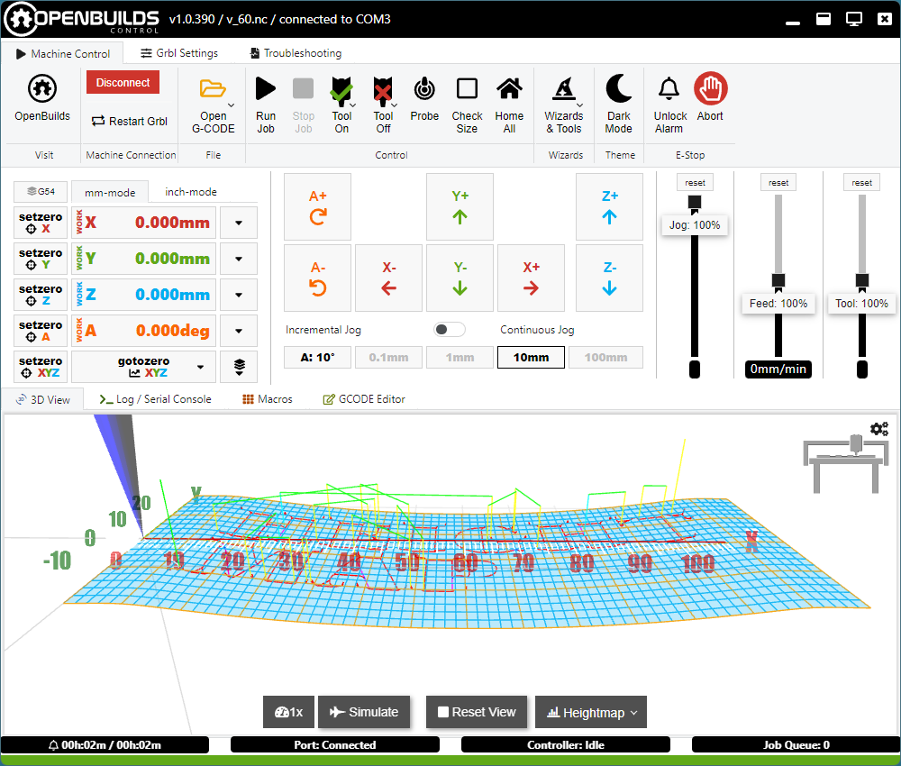
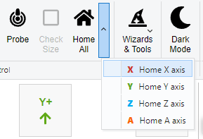
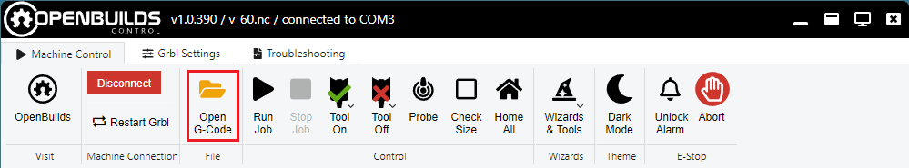

# Useful macros for Groove Control and OpenBuilds

In this folder I keep a collection of useful Javascript macros.

## Macros for the original OpenBuilds that replicate new features from the Groove software

### MacroManager
Allows macro buttons to be organized in groups, which makes large number of macros more manageable.
The group tabs can be horizontal or vertical.

Also has the ability to back up all macros into a single file.

This macro works best when set to autorun on startup.

**Horizontal group tabs**

**Vertical group tabs**

### Heightmap
Adds a heightmap menu to the 3d view. You can generate a heightmap by sampling the surface at multiple points.
The heightmap can then be used to modify the G-code to follow the surface.

## StoreWcs/RestoreWcs
Set the StoreWcs to run on startup. It will record the WCS offset after each job.

Then use RestoreWcs to restore the offset if it is ever lost, like if you accidentally click Set 0.

### SmartHome
Prevents accidental homing if the machine was recently homed. Also allows homing individual axes if the hardware supports it.

Relies on the **homedRecently** status of OpenBuilds.

### OpenFile
Removes the dropdown from the Open G-code button.

It is a simplified version of the original by Thayne Co: https://thayneco.com/single-click-to-open-a-file-browser-in-openbuilds-control/

## Macros that work with both Groove and OpenBuilds

### DisableZ
Disables the Z up/down buttons when the jog step is at the highest setting.
This prevents accidental Z jogs that can plunge into the table.
It is based on the original script by sharmstr - https://github.com/sharmstr/OpenBuildsHacks/blob/main/Macros/HideZBtns.js

Run it automatically on startup.

### MeasureZ
Measures the height of a surface without changing the work zero.
This is useful for making accurate height measurements at different points on the surface.

### SpindleDelay
Pauses the execution after M3 and M4 commands without using the G4 command. Useful on some machines where G4 is not working properly.

### FindHoleCenter
Fast and precise method for finding the center of a circular or rectangular hole.

## Snippets

The Snippets folder contains code fragments that can be reused in future scripts.
The **SequenceFramework** fragment is particularly useful.
It can help develop complex scripts that mix G-code with JavaScript logic.
